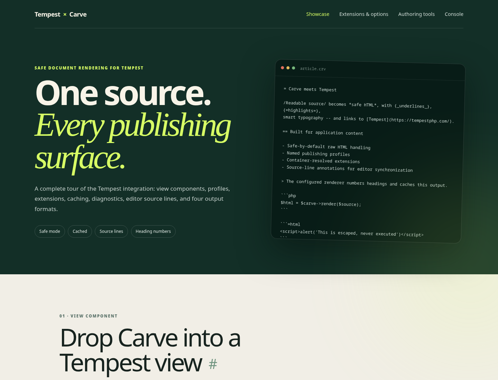

# Tempest Carve demo

A runnable Tempest application showcasing every feature of
[`markup-carve/tempest-carve`](https://github.com/markup-carve/tempest-carve).

**[View the live demo →](https://markup-carve.github.io/tempest-carve-demo/)**

## Requirements

- PHP 8.5+
- Composer
- Node.js 22+

## Installation

```sh
git clone https://github.com/markup-carve/tempest-carve-demo.git
cd tempest-carve-demo
composer install
cp .env.example .env
php tempest key:generate
npm ci
npm run build
php tempest serve
```

Open <http://127.0.0.1:8000>.

The `main` branch is also exported with Tempest's static-page generator and
deployed to [GitHub Pages](https://markup-carve.github.io/tempest-carve-demo/)
by GitHub Actions.



## Features

| Page | Demonstrates |
|---|---|
| `/` Showcase | The `<x-carve>` component; the four profiles side by side; HTML, Markdown, plain text and ANSI from one source; `renderWithReport()` warnings, profile violations and bounded losses; database-backed includes through a container-injected resolver (relative nested rows, `@shift:auto`, a CSV include narrowed with `@rows` and `@cols`, dependency tracking, revision-aware caching); source lines; Tempest Cache |
| `/extensions` | Extensions given as an engine definition (`Navigation::headingNumbers()`), a container-resolved class (`App\Carve\DisclosureExtensions`), and the adapter names `tabs`, `mermaid`, `plantuml`, `fenced_render`, `wikilinks` and `tempest_highlight`; a `WikiLinkUrlTemplate` URL generator; `smartTypography`, `sourceLines`, `sections`, `mode`, `rawHtml`, `urlPolicy` and every `headingIds` value before and after; a per-call profile; `namedRenderers`; a host `text` writer in `writers` |
| `/authoring` | `lint()` and `lintIncluded()`; `format()` with and without `alignTables`; `fromHtml()` and `fromMarkdown()`; the `ValidCarve` rule; a `CarveContent` model property; `strictLosses`; `IncludeOptions` depth, byte and warning limits with `suppressedWarnings` |
| `/console` | Live runs of `carve:render`, `carve:lint`, `carve:fmt` and `carve:convert` |

The tests cover each page, run the console commands, and use the
`CarveAssertions` PHPUnit trait.

Configuration lives in `app/carve.config.php`. The Carve sources are files in
`content/`; `content/snippets/` seeds the in-memory SQLite database used by
the include resolver, so the include example also works during static
deployment. `content/samples/` holds deliberately non-canonical input for the
lint, format and import demos.

The `main` branch runs Carve 0.2: `tempest-carve` from its `main` branch and
`carve-php` pinned to a `main` commit. The `0.1` branch keeps the Carve 0.1
demo.

## Quality

```sh
composer qa
npm run build
php tempest static:generate --crawl
```

## Ecosystem

Part of the [Carve ecosystem](https://github.com/markup-carve). See
[awesome-carve](https://github.com/markup-carve/awesome-carve) for integrations,
implementations, and editor tooling.
